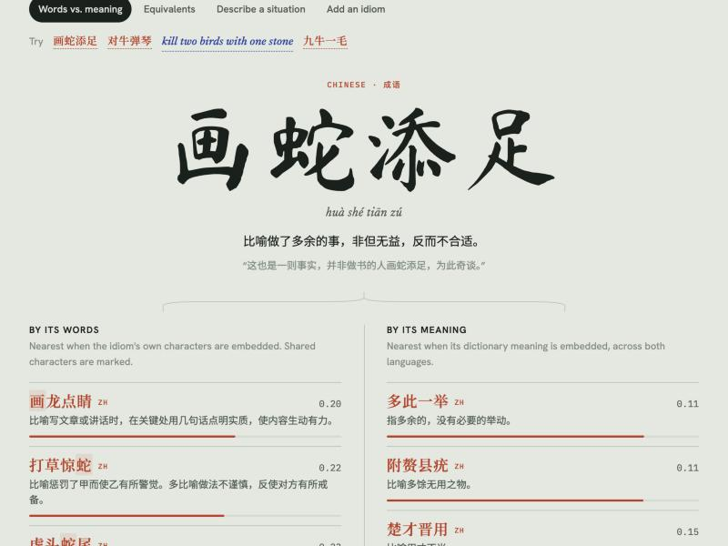

# Idiom Rosetta

Match Chinese and English idioms by what they mean, not what they say.



> ✏️ **Note to self, delete before submitting.** Each section from here down to "AI-generated documentation" is a *draft answer* for me to rewrite in my own words. The assignment requires the first four items and the AI-use summary to be my own writing. Every fact and number in the drafts was checked against the running app, so keep the facts and change the wording.

## What it does and why I chose it

Idiom Rosetta is able to find idioms in both Chinese and English, given a description of it. For example, if we said something like "getting multiple things done with only one action", the top responses will be "Killing two birds with one stone" in English, and "一举两得" (“one act, two gains”) in Chinese. It can also find equivalent idioms between the two languages, as well as full explanations of what each idiom means. I chose this because there is no way to do something like this with simple keyword searches. Idioms are beautiful in the sense that most times, it is unclear what they mean if you just take it in the literal sense, therefore it must be broken down to its meaning before being searched with a vector database.

## What's in the database

- **Sources:** Chinese chengyu from the [chinese-xinhua](https://github.com/pwxcoo/chinese-xinhua) dataset (30,895 entries), and English idioms from the [`englishidioms`](https://pypi.org/project/englishidioms/) package, which bundles 21,866 entries parsed from the *McGraw-Hill Dictionary of American Idioms and Phrasal Verbs*.
- **One item = one idiom:** the idiom itself plus its dictionary meaning. Nothing is chunked, but entries are trimmed. For Chinese, I keep only the figurative part of the explanation, because Xinhua explanations usually start by describing the literal picture. For English, I keep only the sense marked `Fig.` (figurative), cut off at the first example sentence. I drop one- and two-word entries (mostly phrasal verbs) and keep only one of several variants that share a definition.
- **How many:** 2,000 Chinese and 2,000 English idioms (4,000 items), sampled with a fixed seed. A short list of test and showcase idioms is always included. Each item is stored twice, in two collections with the same id: `literal` embeds the idiom's own words, and `meaning` embeds its definition. That's 8,000 vectors.
- **Metadata on each item:** `lang` (`zh`/`en`), `idiom`, `meaning`, `example`, `source` (`xinhua`, `mcgraw-hill`, or `user`), `pinyin`, and `key`, a normalized form used for lookups. Chinese items also carry `meaning_pinyin`, plus `idiom_en` (the literal picture in English) and `meaning_en` (the meaning in English), both translated by Claude. These are display-only and aren't embedded, so they don't affect search.

## How to add and search

**Adding:** in the shell, type `add` and answer the prompts: idiom, language, meaning, and an optional example and pinyin. In the web UI, use the **Add an idiom** tab. Before saving, Rosetta embeds the new meaning and shows the three closest existing ones. If the idiom is already stored, or a meaning is nearly identical (cosine distance below 0.1), it asks before saving. Saved idioms go into both collections and show up in the very next search, with no rebuild. If you look up an idiom that isn't stored, it offers to add it.

**Searching:** there are four ways to search, each a tab in the web UI and a command in the shell.
- `find "<description>"` describes a situation in either language and gets idioms from both. `--lang zh` or `--lang en` narrows it to one.
- `equiv <idiom>` gives the closest idioms in the other language.
- `compare <idiom>` shows two columns: neighbors by the idiom's words vs. by its meaning.
- `explain <idiom>` sends the equivalents to Claude, which says which fits best and how the others differ in tone or usage.

## Two test queries, and why keyword search would miss them

**Query 1: `find "trying to speed things up only makes them worse" --lang zh`**

| # | Idiom | Literally | Meaning | Distance |
| --- | --- | --- | --- | --- |
| 1 | 欲速反迟 | wanting speed, one is instead slow | being overly impatient for quick results only delays reaching one's goal; more haste, less speed | 0.25 |
| 2 | 挖肉补疮 | cut out flesh to patch a sore | to resort to harmful measures to meet an immediate need, heedless of the future | 0.26 |
| 3 | 揠苗助长 | pull up seedlings to help them grow | to violate the natural course of things in one's eagerness for quick results, only to spoil everything | 0.27 |

A keyword search finds nothing here. The query is English, and the stored Chinese idioms and their meanings are in Chinese, so none of the stored Chinese entries contains any query word. A translation dictionary wouldn't help much either: 揠苗助长's words are about seedlings, which the query never mentions. The embedding models place the English description and the Chinese explanation near each other because they mean the same thing.

**Query 2: `equiv carry coals to Newcastle`**

| # | Idiom | Literally | Meaning | Distance |
| --- | --- | --- | --- | --- |
| 1 | 多此一举 | one move too many | a superfluous, unnecessary action | 0.17 |
| 2 | 画蛇添足 | draw a snake and add feet | to do something superfluous that, far from helping, makes things worse | 0.20 |
| 3 | 附赘县疣 | an attached growth, a hanging wart | superfluous, useless things | 0.22 |

The query and its matches share no words, no imagery, and no language: coal and Newcastle versus snakes, feet, and warts. Even translating word by word wouldn't connect them. The only thing they have in common is the idea of doing something redundant, and that's what the meaning collection captures. The `compare` command shows the contrast directly: searched by its own words, 画蛇添足's neighbors are other snake idioms (打草惊蛇, 虎头蛇尾). Searched by its meaning, they're idioms about pointless extra effort.

## How I used AI

I used Claude chat to brainstorm ideas and settle on this final idea. Then I worked with the same chat to produce a comprehensive spec doc including all the features I wanted as well as the steps to get there. Finally I worked with Claude code to incrementally build the project and add/tweak features towards the end.

## Citations

- Chinese idioms: [pwxcoo/chinese-xinhua](https://github.com/pwxcoo/chinese-xinhua), MIT license.
- English idioms: [`englishidioms`](https://pypi.org/project/englishidioms/) by Mahmoud Zaghloul, parsed from the *McGraw-Hill Dictionary of American Idioms and Phrasal Verbs* (Richard A. Spears, McGraw-Hill). The dictionary text is copyrighted and the package allows personal, non-commercial use, so the data is installed locally and never committed to this repo.
- Chen et al., "BGE M3-Embedding: Multi-Lingual, Multi-Functionality, Multi-Granularity Text Embeddings Through Self-Knowledge Distillation," arXiv:2402.03216, 2024 (`BAAI/bge-m3`, MIT license).
- Wang et al., "Multilingual E5 Text Embeddings: A Technical Report," arXiv:2402.05672, 2024 (`intfloat/multilingual-e5-large`, MIT license).
- [Chroma](https://www.trychroma.com/), [sentence-transformers](https://www.sbert.net/), [pypinyin](https://github.com/mozillazg/python-pinyin) (MIT), and the [Anthropic API](https://docs.anthropic.com/) (Claude Opus 5.5).
- Fonts from Google Fonts: Ma Shan Zheng, Noto Serif SC, Noto Sans SC, Newsreader, Hanken Grotesk, IBM Plex Mono.

---

## AI-generated documentation

*Everything below this heading was written by Claude (Claude Code, Claude Opus 5.5) and checked against the code and the running app.*

### Overview

画蛇添足 literally says "draw a snake, add feet", but it means ruining something by overdoing it. Embed its words, and its nearest neighbors are other idioms about snakes. Embed its meaning, and they're idioms about pointless extra effort, in both languages. Idiom Rosetta stores both versions of every idiom in a persistent Chroma database, and the `compare` command shows them side by side. It's a command-line app with an interactive shell, plus a web front end on the same database.

### The finding

On 10 known Chinese↔English equivalent pairs (see [`eval/pairs.csv`](eval/pairs.csv)), the English partner lands in the top 5 of the Chinese idiom's matches:

| Search | Pairs in the top 5 |
| --- | --- |
| By meaning (what `equiv` does) | **6 / 10** |
| By the idiom's own words | 4 / 10 |

The model mattered more than anything else. The spec's starting model, `paraphrase-multilingual-MiniLM-L12-v2`, scored 3/10. I tried the fallbacks and a few more, scoring each on the cleaned data in memory:

| Model | First sample | Final sample |
| --- | --- | --- |
| paraphrase-multilingual-MiniLM-L12-v2 | 3 | 3 |
| sentence-transformers/LaBSE | 3 | 3 |
| paraphrase-multilingual-mpnet-base-v2 | 3 | 3 |
| intfloat/multilingual-e5-large-instruct | 5 | 5 |
| intfloat/multilingual-e5-large | 5 | 5 |
| BAAI/bge-m3 | 5 | 6 |
| **bge-m3 + e5-large ensemble (default)** | **7** | **6** |

The "final sample" adds a showcase list of well-known idioms to the random sample (see [Data](#data)), which gives each Chinese idiom more competitors. The ensemble is never worse than `bge-m3` alone and pulls near-misses closer (九牛一毛 → "a drop in the bucket" moves from rank 9 to 6), but 10 pairs is too few to call it a clear win. A 30–50 pair recall@5 evaluation is the obvious next step.

The ensemble needs no special support from Chroma. Each text is embedded by both models, each vector is normalized, and the two are concatenated and scaled by 1/√2. The cosine similarity of two such vectors is exactly the average of the two models' similarities, so Chroma's ordinary cosine index runs the ensemble ([`rosetta/embed.py`](rosetta/embed.py)).

The four misses are instructive, not noise:

- **画蛇添足 → "gild the lily"**: the top match is "carry coals to Newcastle" ("to do something unnecessary"), which is closer to the Chinese than the dictionary's "add ornament to something already fine".
- **破釜沉舟 → "burn one's bridges"**: McGraw-Hill's figurative sense of "burn one's bridges" is the social one ("act unpleasantly in a situation you're leaving"), not "cut off your retreat". Rosetta finds "cross the Rubicon" instead.
- **守口如瓶 → "my lips are sealed"**: all of the top five are real equivalents ("keep one's mouth shut", "not breathe a word", …); the expected one is phrased as a first-person promise.
- **九牛一毛 → "a drop in the bucket"**: rank 6. Rank 1 is "by the dozens", which means *many*. The embeddings latched onto "quantity" and missed the polarity.

Both false friends from the spec stay apart, as they should. 过河拆桥 (abandoning those who helped you) finds "bite the hand that feeds one", not "burn one's bridges". More in [examples.md](examples.md).

### Vector database and embedding models

- **Vector database:** [Chroma](https://www.trychroma.com/) (`chromadb`), run as an embedded `PersistentClient` that saves to `chroma_db/` in the project folder. There's no server to install. There are two collections, `literal` and `meaning`, both using cosine distance.
- **Embedding models:** an ensemble of [`BAAI/bge-m3`](https://huggingface.co/BAAI/bge-m3) and [`intfloat/multilingual-e5-large`](https://huggingface.co/intfloat/multilingual-e5-large), run locally through `sentence-transformers`. Both map Chinese and English into one shared vector space, which is what lets an English description find a Chinese idiom. Model names live in [`rosetta/embed.py`](rosetta/embed.py).
- **First-run downloads:** the first `build` downloads both models from Hugging Face (about 4.5 GB, cached under `~/.cache/huggingface/` afterwards) and the Xinhua idiom list from GitHub (10 MB). The English idioms come inside the `englishidioms` pip package, about 100 MB, installed by `pip install -r requirements.txt`. The web page also loads its fonts from Google Fonts.
- **Optional:** English translations of Chinese idioms and the `explain` command call the Anthropic API (Claude Opus 5.5) and need a key in `.env`. Without one, everything else works, and Chinese idioms show pinyin but no English.

### Setup

Python 3.11+.

```bash
git clone https://github.com/ebeetles/rosetta.git
```

```bash
cd rosetta && python3 -m venv .venv && source .venv/bin/activate
```

```bash
pip install -r requirements.txt
```

Then build the database once:

```bash
python -m rosetta build
```

`build` downloads the Xinhua idiom list from GitHub (10 MB), reads the English idioms from the `englishidioms` package, cleans both into `data/clean/{zh,en}.jsonl`, and embeds them into `chroma_db/`. The first run also downloads the two embedding models from Hugging Face, about **4.5 GB** in total. After that, embedding the 4,000 idioms takes under a minute on an Apple-silicon laptop.

`build` then adds pinyin and English to every Chinese idiom (see [Pinyin and English](#pinyin-and-english)). Pinyin is computed offline. English translations come from Claude and need an API key; without one, `build` adds pinyin only and says so. Add `--no-translate` to skip translation even when a key is set.

Rerunning `build` is safe: it skips anything already stored, embedded, or translated.

For a much smaller download (about 470 MB), use the original model. It scores lower (3/10), but every command works the same:

```bash
export ROSETTA_MODELS=paraphrase-multilingual-MiniLM-L12-v2
```

The store remembers which models built it. If you switch, delete `chroma_db/` and run `build` again.

`data/` and `chroma_db/` are gitignored. The English entries are copyrighted dictionary text, so `build` fetches everything locally and nothing is committed.

### Usage

`python -m rosetta` opens the shell. Every command also works one-shot, as in `python -m rosetta equiv 画蛇添足`.

```
$ python -m rosetta
Idiom Rosetta  画蛇添足 ≈ gild the lily
4,000 idioms (2,000 zh, 2,000 en). Type 'help' for commands.

rosetta› equiv 易如反掌
易如反掌  yì rú fǎn zhǎng  —  比喻事情非常容易做。
  1.  piece of cake           0.15  something easy to do.
  2.  It's a cinch            0.17  It's a very easy task.
  3.  sail through something  0.17  to go through something very quickly and easily.
  ...
```

| Command | What it does |
| --- | --- |
| `build [--no-translate]` | Download, clean, and embed both datasets, then add pinyin and English to Chinese idioms. Skips what's already done. |
| `find <description> [--lang zh\|en] [-k N]` | Idioms whose meaning fits a plain-language description, in either language |
| `equiv <idiom> [-k N]` | The closest idioms in the other language, with meanings and distances |
| `compare <idiom> [-k N]` | Two columns: nearest by the idiom's words vs. nearest by its meaning |
| `add` | Prompts for an idiom, language, meaning, and optional example and pinyin. Shows the closest existing meanings first and asks before saving a likely duplicate (exact name match, or cosine distance below 0.1). New Chinese idioms get pinyin, and English if a key is set. |
| `explain <idiom>` | Sends the `equiv` results to Claude, which says which match is closest and how the others differ |
| `stats` | Counts per collection and language, how many idioms you've added, pinyin and English coverage, and the embedding models |
| `serve [--port 8000]` | Starts the web front end |

Distances are cosine distances: 0 means the same, 1 means unrelated. If you `equiv` an idiom that isn't stored, Rosetta offers to `add` it instead of guessing.

**Persistence:** run `add`, quit, start a new shell, and run `stats`. "added by you" still counts it, and `find` still finds it.

#### Web front end

```bash
python -m rosetta serve
```

Then open http://127.0.0.1:8000. It runs on the same `db.py` as the shell, so anything you add in one shows up in the other. It covers every CLI command:

| CLI | Web |
| --- | --- |
| `compare`, `equiv`, `find`, `add` | The four tabs under the search box. `find`'s `--lang` is the Both / 中文 / English filter. |
| `-k N` | The **Results** menu (auto uses each command's default) |
| `explain` | **Ask Claude how these differ** under the equivalents list |
| `stats`, `build` | The **Database** page, linked from the counts in the header: counts, pinyin and English coverage, models, storage path, and a **Run build** button with live progress. A fresh install with an empty database opens here. |

Every Chinese idiom shows its pinyin, a literal English rendering of the idiom, and its explanation with pinyin and an English translation. The **Show: Pinyin / English** toggles hide either one; the choice is remembered in your browser.

Run either the shell or the server against `chroma_db/` at one time, not both. After pulling new code, restart the server to pick it up.

#### Claude features (optional)

Two features use Claude (`claude-opus-5-5`) through the Anthropic API: `explain`, and the English translations of Chinese idioms. Copy `.env.example` to `.env` and add your key:

```
ANTHROPIC_API_KEY=sk-ant-...
```

Without a key, `explain` prints a one-line message, Chinese idioms show pinyin but no English, and everything else works as normal.

Translating all 2,000 chengyu takes about 50 requests of 40 idioms each, run 4 at a time, and costs roughly $3 the first time. Results are cached in `data/translations.json`, so later builds, and rebuilds from scratch, don't pay again.

### How it works

```
chinese-xinhua idiom.json ─┐                     ┌─ literal  collection  (embeds "画蛇添足")
                           ├─ data.py ─ jsonl ───┤
englishidioms phrases.json ┘                     └─ meaning  collection  (embeds "比喻做了多余的事…")
```

Both collections hold the same ids and metadata (`lang`, `idiom`, `meaning`, `example`, `pinyin`, `source`). The only difference is which text is embedded.

- `find` embeds your text and queries `meaning` (with a `lang` filter for `--lang`).
- `equiv` fetches the idiom's *stored* meaning vector and queries `meaning` for the other language, so the search always starts from the meaning, never the words.
- `compare` runs the same lookup twice: the literal vector against `literal`, and the meaning vector against `meaning`.
- `add` embeds the new meaning, checks the nearest existing one, then writes to both collections.

#### Data

- **Chinese** ([chinese-xinhua](https://github.com/pwxcoo/chinese-xinhua)): four-character entries with a real explanation, preferring ones that have an example sentence. Xinhua explanations usually open with the literal picture ("画蛇时给蛇添上脚。比喻…"), so cleaning keeps only the figurative sense, from 比喻 / 形容 / 指 onward, and stops at secondary senses (也比喻…). Otherwise the literal words would leak into the meaning embedding.
- **English** ([englishidioms](https://pypi.org/project/englishidioms/), from the McGraw-Hill Dictionary of American Idioms and Phrasal Verbs): entries marked `Fig.`, keeping only the figurative sense up to the first example. Usage notes in parentheses are removed. One- and two-word entries (mostly phrasal verbs) are dropped, and variants with identical definitions ("easy as pie", "easy as A, B, C") are kept once.
- **Sampling:** about 2,000 per language with `seed=42`. The Phase 3 pairs and a short showcase list (the snake idioms that make `compare 画蛇添足` work, and famous idioms people try first) are always included. These are listed in `rosetta/data.py`.

Two substitutions in the eval pairs, because the original idioms aren't in the English dataset: 守口如瓶 is paired with "my lips are sealed" instead of "keep one's lips sealed", and 亡羊补牢's false friend is "too little, too late" instead of "lock the barn door after the horse is stolen".

#### Pinyin and English

Chinese entries carry four extra metadata fields, filled in by [`rosetta/enrich.py`](rosetta/enrich.py) after embedding:

| Field | Example | Source |
| --- | --- | --- |
| `pinyin` | huà shé tiān zú | Xinhua; `pypinyin` for idioms you add |
| `meaning_pinyin` | bǐ yù zuò le duō yú de shì, … | `pypinyin` |
| `idiom_en` | draw a snake and add feet | Claude: the idiom's literal picture |
| `meaning_en` | to do something superfluous that, far from helping, makes things worse | Claude: the explanation, as a dictionary gloss |

These are display-only. They're written with a metadata update, so nothing is re-embedded, and the meaning collection still embeds the Chinese explanation: search results and the eval numbers don't change. A free local translation model (`Helsinki-NLP/opus-mt-zh-en`) was tried first and rejected: it rendered 九牛一毛 as "Nine cents" and 班门弄斧 as "Benson makes axes".

#### Reproduce the eval

```bash
python -m eval.check
```

```bash
python -m eval.check --literal
```

### Layout

```
rosetta/
  __main__.py   entry point: shell or one-shot command
  cli.py        command parsing, rich output, the shell
  data.py       download + clean both datasets
  embed.py      the embedding models (names live only here)
  db.py         PersistentClient, the two collections, query helpers
  enrich.py     pinyin and English for Chinese idioms
  explain.py    optional Claude call, and the shared API key check
  web.py        FastAPI app for the web front end
web/index.html  the web front end
eval/           test pairs and the Phase 3 check
examples.md     curated results, including failures
```
